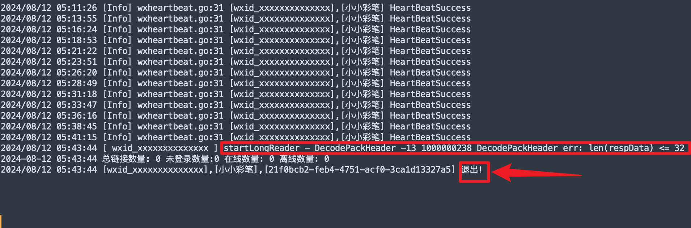
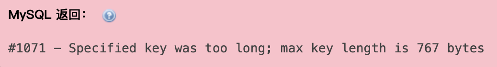

<h1 align="center">🚀 v8080以更新在贊助群獲取</h1>

<div align="center">
  
</div>

<h1 align="center">🚀 基於 WeChat Pad 協議的高級管理工具v875</h1>

<div align="center">
  <strong>🌐 <a href="https://gwpad.com/">在線演示系統</a> - 默認密碼:adminkey = 28d21d0f9748172c970ba4c208af5564</strong>
</div>

<p align="center">
  <a href="https://github.com/WeChatPadPro/WeChatPadPro">
    
  </a>
  <a href="https://github.com/WeChatPadPro/WeChatPadPro">
    
  </a>
  <a href="https://t.me/+LK0JuqLxjmk0ZjRh">
    
  </a>
  <br>
  <a href="https://github.com/WeChatPadPro/WeChatPadPro/stargazers">
    
  </a>
  <a href="https://github.com/WeChatPadPro/WeChatPadPro/network/members">
    
  </a>
  <a href="https://github.com/WeChatPadPro/WeChatPadPro/issues">
    
  </a>
</p>

<div align="center">
  <strong>⭐️ 歡迎 Star，獲取專案最新動態！⭐️</strong>
</div>
 ---

# ☁️ GWPad Cloud 云端服务

> 基于微信 PAD 协议的云端 API 服务，为开发者提供微信账号接入、消息交互、事件订阅及多账号管理能力。

**无需自行部署协议服务器，通过云端 API 快速集成微信能力。**

### 🌐 服务入口

| 服务 | 地址 |
| --- | --- |
| GWPad 官方网站 | https://gwpad.com/ |
| Cloud 云端控制台 | https://cloud.wechatpadpro.com/ |
| Cloud API 接口文档 | https://gwpad.com/Cloudswagger/index.html |
| Cloud API 地址 | https://api.wechatpadpro.com/v1 |

---

## 🚀 一、云端服务介绍

GWPad Cloud 是面向开发者、软件服务商及业务系统的微信 PAD 协议 API 云端服务。

通过统一的 REST API、Webhook 和 WebSocket 接口，开发者可以将微信账号能力集成到自己的应用程序中。

### 核心特点

- **云端托管**：无需自行部署微信协议服务端。
- **扫码接入**：通过云端工作台连接微信账号。
- **多账号管理**：统一管理多个微信节点。
- **统一 API**：使用标准 HTTP 接口对接业务系统。
- **实时事件**：支持 Webhook 与 WebSocket 事件接入。
- **独立凭证**：各节点使用独立 Access Token。
- **网络出口管理**：支持 Cloud Agent、自定义代理及 AID 网络出口。
- **持续更新**：云端统一维护服务及协议适配能力。

GWPad Cloud 专注于协议连接与 API 基础能力，不提供开箱即用的 CRM、客服系统或营销运营后台。

---

## ⚡ 二、快速开始

### 1. 注册云端账号

访问官方网站：

https://gwpad.com/

进入 Cloud 云端工作区：

https://cloud.wechatpadpro.com/

按照页面提示完成账号注册和登录。

### 2. 创建微信节点

在 Cloud 工作台中：

1. 创建或选择微信节点。
2. 选择支持的设备接入方式。
3. 配置节点所需的网络出口。
4. 获取登录二维码。
5. 使用微信完成扫码及必要验证。
6. 确认节点连接状态。

> 扫码成功后，应检查节点状态及账号授权，再进行 API 调用。

### 3. 获取节点 Access Token

每个微信节点具有独立的 Access Token。

调用业务 API 时，使用以下请求头：

```http
X-Cloud-Access-Token: YOUR_CLOUD_ACCESS_TOKEN
```

工作区管理凭证与节点 Access Token 相互独立，请勿混用。

### 4. 调用 API

Cloud API 基础地址：

```text
https://api.wechatpadpro.com/v1
```

发送文字消息示例：

```bash
curl --request POST \
  --url 'https://api.wechatpadpro.com/v1/Msg/SendText' \
  --header 'X-Cloud-Access-Token: YOUR_CLOUD_ACCESS_TOKEN' \
  --header 'Content-Type: application/json' \
  --data '{
    "to": "wxid_demo",
    "content": "Hello Cloud"
  }'
```

> 示例参数以当前 Swagger 接口定义为准。

完整 API 文档：

https://gwpad.com/Cloudswagger/index.html

---

## 🔑 三、API 鉴权机制

Cloud 采用分层凭证管理方式。

### 节点 Access Token

用于访问对应微信节点的业务接口。

```http
X-Cloud-Access-Token: YOUR_CLOUD_ACCESS_TOKEN
```

### 工作区管理凭证

用于需要管理权限的操作。

Cloud Swagger 提供以下管理鉴权字段：

```http
X-Admin-cloudToken: YOUR_ADMIN_TOKEN
```

### 安全建议

- 不要在 GitHub 仓库中公开 Token。
- 不要将 Token 硬编码到前端页面。
- 建议通过自己的服务端调用 Cloud API。
- 不同微信节点分别管理凭证。
- 定期检查账号授权及节点状态。

---

## 🧩 四、云端 API 功能模块

GWPad Cloud 提供多类微信业务接口。

以下为功能模块概览，具体接口名称、参数及可用权限请以最新 Cloud Swagger 为准。

### 1. 登录与节点管理

- 登录二维码获取
- 扫码状态检查
- 登录状态查询
- 节点连接管理
- 会话状态管理
- 节点运行状态查询

### 2. 消息能力

- 文本消息
- 图片消息
- 文件消息
- 视频消息
- 语音消息
- 链接与其他消息类型
- 消息及会话相关操作

### 3. 联系人与好友

- 联系人资料查询
- 好友信息查询
- 联系人相关管理
- 联系人与会话数据获取

### 4. 群聊与会话

- 群聊信息
- 群成员查询
- 群消息交互
- 群聊管理相关接口
- 会话数据与状态查询

### 5. 搜索与内容

- 微信相关搜索能力
- 公众号相关接口
- 内容查询接口

### 6. 小程序

- 小程序相关业务接口
- 小程序信息与交互能力
- 小程序业务数据查询

### 7. 视频号与直播

- 视频号相关接口
- 直播相关接口
- 业务数据查询与交互

### 8. 小微业务

- 小微权限及业务管理
- 邀请与相关操作
- 历史数据与摘要
- 记忆及实时对话相关接口

新版 Cloud 文档单独介绍了小微业务模块及其
35 个业务接口。

### 9. 实时事件

- Webhook 消息回调
- WebSocket 实时连接
- 消息事件接收
- 节点状态事件
- 业务事件处理

> 注意：模块概览并不代表所有微信账号、设备类型或套餐均支持全部操作。请以实际授权与在线文档为准。

---

## 🔔 五、Webhook 与 WebSocket

GWPad Cloud 支持通过 Webhook 或 WebSocket 接收实时业务事件。

### Webhook

适用于已经具有服务端 HTTP 接口的应用。

业务服务器可以通过 HTTPS 接收平台推送的事件，并按照业务逻辑进行处理。

### WebSocket

适用于需要持续接收实时事件的开发者应用。

Cloud 文档描述的连接方式包含：

1. 使用节点 Access Token 获取短时连接票据。
2. 使用票据建立 WebSocket 连接。
3. 接收对应节点的实时事件。
4. 连接中断后按照接口要求重新获取票据并建立连接。

### 推荐的业务接入方式

```text
微信账号
   ↓
GWPad Cloud
   ↓
Webhook / WebSocket
   ↓
开发者业务服务器
   ↓
CRM / SaaS / AI Agent / 自有应用
```

业务端建议自行实现事件去重、消费确认、异常处理与有限重试。

---

## 🌐 六、云端网络出口

使用 GWPad Cloud 时，无需自行部署云端协议服务端。

但微信节点可能需要根据接入环境配置网络出口。

当前文档涉及以下方式：

### 1. Cloud Agent

用户在适合的网络环境中运行 Cloud Agent，协助微信节点建立所需连接。

使用过程中，应保持 Agent 客户端及其网络可用。

### 2. 自定义网络代理

根据实际节点支持情况，配置符合要求的代理服务器。

### 3. AID 网络出口

通过客户端提供的 AID 标识，将指定网络环境接入云端节点。

此方式适用于需要使用自有网络出口的接入场景。

> 网络出口是否可用，以及支持的代理类型和配置方式，以 Cloud 工作区实际提供的功能为准。

---

## 🛠️ 七、云端运行与管理

Cloud 工作区用于微信节点的接入与运行管理。

主要包括：

- 微信节点创建及连接
- 登录与会话状态管理
- 多账号节点管理
- 节点 Access Token 管理
- 节点网络出口配置
- 运行状态及日志查看
- 云端服务授权管理

开发者可以通过 Cloud API 将微信能力集成到自己的产品中，无需使用平台提供的成品业务运营系统。

---

## 📢 八、云端版本更新

### 2026-11-05 · GWPad Cloud 正式更新

本次更新已完成生产环境切换。

**主要更新：**

- GWPad 新域名服务正式上线。
- 协议服务及云端控制后台同步更新。
- API 文档入口更新。
- 完善视频号相关接口。
- 新增直播相关接口入口。
- 扩展小程序相关接口。
- 新增小微业务接口。
- 优化 WebSocket 与 Webhook 字段一致性。
- 完善消息解析与相关兼容处理。
- 修订表情消息发送及搜索能力。

**接口扩展：**

与前一线上前端公开文档版本比较：

| 项目 | 数量 |
| --- | ---: |
| 更新前接口路径 | 344 |
| 更新后接口路径 | 401 |
| 新增接口路径 | 57 |
| 删除接口路径 | 0 |

新增路径分类：

| 模块 | 新增路径 |
| --- | ---: |
| 视频号 | 9 |
| 直播 | 9 |
| 小程序 | 8 |
| 小微 | 31 |

以上为 2026-11-05 发布时的接口路径对比，
不代表后续版本的固定接口总数。

请通过在线 Swagger 获取最新接口定义。

---

## 💰 九、云端服务授权

GWPad Cloud 采用独立的云端服务授权与计费方案。

开发者可以通过官方网站了解当前可用方案：

https://gwpad.com/

云端服务费用、套餐权限、节点数量及可用周期，
以官网当前展示、实际账号授权及购买约定为准。

免费注册账号不代表自动获得全部 API 权限或免费试用资格。

如需商业合作、批量节点或定制接入方案，
请通过官方网站提供的渠道联系。

---

## ❓ 十、常见问题

### Q1：使用 Cloud 需要自己部署服务器吗？

无需自行部署微信协议服务器。

如果使用 Cloud Agent 或自有网络出口，
仍需保持相应客户端和网络环境正常运行。

### Q2：支持多个微信账号吗？

支持在工作区管理多个微信节点。

各节点凭证、连接状态与实际授权分别管理。

### Q3：如何查看所有接口？

访问：

https://gwpad.com/Cloudswagger/index.html

通过接口目录查看路径、请求参数、响应结构及示例。

### Q4：Cloud 可以直接用作 CRM 吗？

不可以。

GWPad Cloud 提供的是微信协议 API 基础能力，
开发者需要自行构建 CRM、客服、运营或其他业务系统。

### Q5：Cloud 是否支持 Webhook？

支持。

同时提供 WebSocket 实时事件接入方式。

### Q6：能否直接使用旧版 WeChatPadPro 接口？

不能默认认为兼容。

历史版本与新版 Cloud 的接口路径、鉴权方式、
请求参数及响应结构可能不同。

新项目应优先使用 Cloud Swagger 中的正式定义。

### Q7：是否保证所有微信账号都可以稳定登录？

不作此保证。

实际连接受账号状态、登录验证、网络环境、
协议适配及微信平台规则等因素影响。

---

## 📚 十一、开发者资源

| 资源 | 链接 |
| --- | --- |
| 官方网站 | https://gwpad.com/ |
| Cloud 工作区 | https://cloud.wechatpadpro.com/ |
| Cloud Swagger | https://gwpad.com/Cloudswagger/index.html |
| API 基础地址 | https://api.wechatpadpro.com/v1 |

---

## ⚠️ 使用说明

GWPad Cloud 是独立的第三方微信协议 API 服务，
不属于微信官方产品，也不代表获得微信官方授权。

开发者应遵守适用法律法规及相关平台规则，
妥善管理账号凭证和用户数据。

API 服务的可用性、接口权限及支持范围，
以当前正式文档与实际授权为准。

---

**GWPad Cloud — 让微信能力更容易集成到你的应用。**

官网：https://gwpad.com/

API 文档：https://gwpad.com/Cloudswagger/index.html

---
<p align="center">
  <a href="#-專案介紹">📋 專案介紹</a> •
  <a href="#-功能特性">📝 功能特性</a> •
  <a href="#-系統包下載">📦 系統包下載</a> •
  <a href="#-更新日誌-changelog">📅 更新日誌</a> •
  <a href="#-快速部署-docker">🚀 Docker部署</a> •
  <a href="#-使用指南與注意事項">📖 使用說明</a> •
  <a href="#-風控指南">🛡️ 風控指南</a> •
  <a href="#-贊助支持">💰 贊助支持</a>
</p>

<div align="center">
  <table>
    <tr>
      <td align="center">
        <a href="https://github.com/WeChatPadPro/WeChatPadPro/releases">
          
        </a>
      </td>
      <td align="center">
        <a href="https://github.com/WeChatPadPro/WeChatPadPro/commits/main">
          
        </a>
      </td>
      <td align="center">
        <a href="https://github.com/WeChatPadPro/WeChatPadPro/issues">
          
        </a>
      </td>
      <td align="center">
        <a href="https://github.com/WeChatPadPro/WeChatPadPro/pulls">
          
        </a>
      </td>
    </tr>
  </table>
</div>

---
## 📢 加入官方交流群

<div align="center">
  <h3>🌟 加入我們的官方交流群和論壇，獲取最新版本更新、技術支援和使用教程！</h3>
</div>

<div align="center">

|                                                                                                                                                                    💬 Telegram 交流群                                                                                                                                                                   |                                                                                                                                                                   💼 微信付費專業群                                                                                                                                                                   |                                                                                                                                                                                                          🔔 釘釘交流群                                                                                                                                                                                                          |                                                                                                                             🌐 Know Hub 在線論壇                                                                                                                             |
| :--------------------------------------------------------------------------------------------------------------------------------------------------------------------------------------------------------------------------------------------------------------------------------------------------------------------------------------------------: | :--------------------------------------------------------------------------------------------------------------------------------------------------------------------------------------------------------------------------------------------------------------------------------------------------------------------------------------------: | :------------------------------------------------------------------------------------------------------------------------------------------------------------------------------------------------------------------------------------------------------------------------------------------------------------------------------------------------------------------------------------------------------------------------: | :----------------------------------------------------------------------------------------------------------------------------------------------------------------------------------------------------------------------------------------------------------------------: |
| <br><br><a href="https://t.me/WeChatPadPro1"></a><br><br>📊 成員數量: 1400+ 位用戶<br>🔔 即時更新通知<br>💡 技術問題解答<br>💬 使用經驗分享 | <br><br><div style="background: #FF6B35; color: white; padding: 8px 16px; border-radius: 20px; font-weight: bold; font-size: 14px; display: inline-block;">🔒 掃碼付費加入專業群</div><br><br>⭐ VIP技術支持<br>🚀 專屬功能體驗<br>⚡ 優先解決問題<br>搶先體驗最新868<br>🎯 高級使用技巧分享 | <br><br><a href="https://qr.dingtalk.com/action/joingroup?code=v1,k1,6TcvBk+ycY8YBgjzUq5vXS4M3XzeIiZAMtozGQtuNQQ=&_dt_no_comment=1&origin=11"></a><br><br>💻 技術討論<br>❓ 問題解答<br>💡 使用經驗分享 | <p>探索與交流 Know Hub 的無限可能</p><br><a href="https://bbs.knowhub.cloud/"></a><br><br>📚 WeChatPadPro交流群<br>💬 技術問題討論<br>📖 安裝使用指南<br>🆕 新需求反饋<br>📋 文檔中心 |

</div>

## 💰 贊助支持


<div align="center">
  <h2>您的支持是我們持續更新的動力</h2>
  <p style="font-size: 18px; margin: 20px 0;">🌟 每一份贊助都是對我們最大的鼓勵 🌟</p>

  <a href="https://buy.stripe.com/7sY8wP3iO9Zv1rn5D30Jq07">
    
  </a>

<br><br>

### 🌟 成為贊助者可獲得

- ✅ **優先技術支援** - 獲得開發者直接回應
- ✅ **新功能優先體驗** - 提前體驗最新功能
- ✅ **客製化需求支援** - 您的需求將被優先考慮
- ✅ **企業級多帳號解決方案** - 適合商業用戶
- ✅ **高級API支援** - 更多高級介面調用能力

  <br>

### 🚀 立即行動

  <a href="https://book.stripe.com/00w6oHbPkc7D1rn0iJ0Jq06">
    
  </a>

  <p style="font-size: 16px; margin: 10px 0;">💳 安全支付 · ⚡ 即時開通</p>

  <br>

> 💡 **提示**: 完成贊助後，請保留交易號並聯繫我們獲取贊助者特權
</div>

# WeChat API & iPad 協議使用說明與風控防範教程（2025 年更新）

本教程旨在協助開發者全面了解 WeChat API 平台與 iPad 協議的登入行為、介面使用限制、風控策略及預防措施，確保使用穩定、安全、高效。
## 🚀 快速部署 (Docker)

如果您想快速部署 WeChatPadPro，我們提供了 Docker 部署方案，只需幾個簡單步驟即可完成部署：

### 1. 克隆項目

```bash
git clone https://github.com/WeChatPadPro/WeChatPadPro.git
cd WeChatPadPro/deploy
```

### 2. 配置環境變數

編輯 `.env` 文件，根據您的需求修改配置：

```ini
# MySQL配置
MYSQL_ROOT_PASSWORD=root123456
MYSQL_DATABASE=weixin
MYSQL_USER=weixin
MYSQL_PASSWORD=123456
MYSQL_PORT=3306

# Redis配置
REDIS_PASSWORD=123456
REDIS_PORT=6379

# WeChat Pad Pro配置
WECHAT_PORT=8080
DB_HOST=wechatpadpro_mysql
DB_PORT=3306
DB_DATABASE=weixin
DB_USERNAME=weixin
DB_PASSWORD=123456
REDIS_HOST=wechatpadpro_redis
REDIS_DB=0

# 管理員密鑰（建議使用複雜的隨機字符串）
ADMIN_KEY=999222
```

### 3. 啟動服務

```bash
docker-compose up -d
```

### 4. 訪問服務

啟動成功後，您可以通過以下地址訪問服務：

```
http://您的伺服器IP:1238
```

### 5. 常用命令

```bash
# 查看服務狀態
docker-compose ps

# 查看日誌
docker-compose logs -f

# 停止服務
docker-compose down

# 重啟服務
docker-compose restart
```

> 📝 **提示**：Docker 部署是最簡單快捷的方式，適合大多數用戶。如果您需要更多自定義配置，請參考下方的完整環境配置。

## 📋 快速開始

在開始使用本專案之前，請務必：

1. 📚 仔細閱讀[風控指南](#-風控指南)，了解帳號安全事項
2. 🐳 選擇部署方式：
  - [Docker快速部署](#-快速部署-docker)（推薦：簡單快捷）
  - [傳統部署](#-環境配置)（適合需要自定義配置的用戶）
3. 🔒 遵循[登入注意事項](#登入注意事項)進行首次登入
4. 🧪 參考[測試指南](#-測試指南)進行功能測試

> ⚠️ **特別提醒**：新帳號請務必遵循[新帳號使用建議](#-重要提醒)，避免觸發風控！

## 📋 專案介紹

WeChatPadPro 是一個功能強大的 WeChat 管理工具，基於 WeChat Pad 協議開發。本專案致力於提供穩定、高效的 WeChat 自動化解決方案，支援多帳號管理、訊息處理、自動化任務等功能。

### 🌟 主要特點

- 🛡️ **安全可靠**: 採用最新的 WeChat Pad 協議，確保帳號安全
- 🔄 **自動化處理**: 支援訊息自動回覆、群管理等自動化操作
- 🎯 **精準控制**: 提供細粒度的功能控制和配置選項
- 🔌 **擴展性強**: 支援外掛系統，可自定義擴展功能
- 📊 **資料同步**: 支援多裝置資料同步，確保資訊統一

### 🎯 適用場景

- 👥 個人用戶：訊息管理、自動回覆、防撤回等
- 🏢 企業用戶：客戶管理、批量操作、資料分析等
- 🤖 開發者：二次開發、功能擴展、自動化整合等

### 📦 環境要求

- MySQL 5.7+ (推薦)
- Redis
- 穩定的網路環境
- 支援 Windows/Linux 系統

---


---
## 📝 功能特性

WeChatPadPro 是基於 WeChat Pad 協議的高級 WeChat 管理工具，支援以下功能：

### 🔐 **微信登录验证码API功能** ⭐ **重点功能**

#### 1. **多种登录方式支持**
- ✅ **二维码登录** - 支持获取登录二维码，绕过验证码流程
- ✅ **验证码登录** - 自动处理验证码提交，无需手动获取ticket
- ✅ **短信登录** - 支持短信验证码登录方式
- ✅ **设备登录** - 支持A16数据登录和设备ID登录

#### 2. **自动验证码处理**
- ✅ **自动获取ticket** - 系统自动从Redis或状态缓存中获取ticket
- ✅ **自动生成data62** - 如果data62为空，系统会自动根据设备信息生成
- ✅ **多重数据源** - 从Redis、状态缓存、用户信息、连接管理器等多个来源获取ticket
- ✅ **智能参数验证** - 自动检查必要参数，提供友好错误提示

#### 3. **实时状态检测**
- ✅ **登录状态监控** - 实时检测扫码状态和登录进度
- ✅ **验证码状态跟踪** - 自动识别是否需要验证码
- ✅ **连接健康检查** - 实时监控连接状态，自动检测连接健康度
- ✅ **心跳监控** - 增加心跳时间记录，超过10秒无心跳认为连接不健康

#### 4. **RabbitMQ消息队列支持**
- ✅ **智能重连机制** - 只在连接确实断开时才重连，避免频繁重连
- ✅ **连接健康检查** - 实时监控连接状态，自动检测连接健康度
- ✅ **并发安全** - 使用互斥锁确保重连过程的线程安全
- ✅ **消息持久化** - 确保消息在服务器重启后不丢失

#### 5. **多账号管理**
- ✅ **多账号并行** - 支持同时管理多个微信账号
- ✅ **账号隔离** - 每个账号独立运行，互不影响
- ✅ **统一管理** - 通过统一接口管理所有账号状态

#### 6. **自动Token刷新**
- ✅ **自动刷新** - 系统自动检测并刷新过期的Token
- ✅ **无缝切换** - Token刷新过程中不影响正常使用
- ✅ **状态同步** - 刷新后自动同步所有相关状态

### 🔄 **API接口列表**

#### 登录相关接口
- `POST /api/login/qr/newx` - 获取微信登录二维码（绕过验证码）
- `POST /api/login/AutoVerificationcode` - 自动处理验证码提交
- `GET /api/login/CheckLoginStatus` - 检测扫码登录状态
- `POST /api/login/verify/auto` - 自动处理验证码（推荐）
- `POST /api/login/verify/manual` - 手动处理验证码

#### 状态检测接口
- `GET /api/login/GetLoginStatus` - 获取在线状态
- `GET /api/login/GetInItStatus` - 初始化状态
- `GET /api/login/CheckCanSetAlias` - 检测微信登录环境

#### 设备管理接口
- `POST /api/login/DeviceLogin` - 设备登录
- `POST /api/login/A16Login` - A16数据登录
- `POST /api/login/SmsLogin` - 短信登录

---

### 🔹 基礎功能

<table>
<tr>
<td width="50%" valign="top">

#### 💬 **訊息收發**
- 文字、圖片、名片、動圖、檔案

#### 👥 **好友管理**
- 新增、刪除、清理殭屍粉

#### 🔄 **朋友圈互動**
- 發布、點讚、評論

#### 💲 **WeChat 支付**
- 轉帳、紅包

</td>
<td width="50%" valign="top">

#### 🔖 **小程式和名片分享**
#### 📇 **通訊錄好友新增**
#### ⭐ **WeChat 收藏**
#### 🏷️ **標籤管理**

</td>
</tr>
</table>

### 🔹 增強功能

- 🔧 **MCP 增強功能**
  - 多協議適配：自動識別並適配不同版本 WeChat 協議
  - 自動化管理：通過配置實現請求自動通過、訊息同步
- 🤖 **自動化功能**
  - 自動搶紅包、訊息防撤回
  - 自動通過好友請求
  - 多群訊息同步
- 👑 **高級群管理**
  - 建群、拉人、踢人、邀請成員
  - 群公告發布、修改群名稱

---

## 📦 系統包下載

<div align="center">
  <h3>🚀 最新版本系統包</h3>
  <p>支持多平台、多架構的系統包下載</p>

  <a href="https://github.com/WeChatPadPro/WeChatPadPro/releases">
    
  </a>
</div>

### 🖥️ 支持平台

| 操作系統 | 支持的架構 | 檔案名 |
|---------|-----------|-------|
| Windows | AMD64 (x86_64) | wechatpadpro_v860_20250704_windows-amd64.zip |
| Windows | ARM64 | wechatpadpro_v860_20250704_windows-arm64.zip |
| macOS | AMD64 (Intel) | wechatpadpro_v860_20250704_macos-amd64.zip |
| macOS | ARM64 (M1/M2) | wechatpadpro_v860_20250704_macos-arm64.zip |
| Linux | AMD64 (x86_64) | wechatpadpro_v860_20250704_linux-amd64.zip |
| Linux | ARM64 | wechatpadpro_v860_20250704_linux-arm64.zip |
| Linux | MIPS64 | wechatpadpro_v860_20250704_linux-mips64.zip |
| Linux | MIPS64LE | wechatpadpro_v860_20250704_linux-mips64le.zip |
| Linux | PPC64 | wechatpadpro_v860_20250704_linux-ppc64.zip |
| Linux | PPC64LE | wechatpadpro_v860_20250704_linux-ppc64le.zip |
| Linux | RISC-V 64 | wechatpadpro_v860_20250704_linux-riscv64.zip |
| FreeBSD | AMD64 | wechatpadpro_v860_20250704_freebsd-amd64.zip |
| FreeBSD | ARM64 | wechatpadpro_v860_20250704_freebsd-arm64.zip |
| OpenBSD | AMD64 | wechatpadpro_v860_20250704_openbsd-amd64.zip |
| OpenBSD | ARM64 | wechatpadpro_v860_20250704_openbsd-arm64.zip |

### 📋 安裝說明

#### 系統要求
- 操作系統：Windows 7+、macOS 10.13+、Linux (內核 3.10+)、FreeBSD 12+、OpenBSD 6.8+
- 記憶體：至少 2GB RAM
- 儲存：至少 200MB 可用空間
- 網路：穩定的互聯網連接

#### 安裝步驟
1. **下載**：根據您的操作系統和CPU架構，從上表中選擇對應的壓縮包下載
2. **解壓**：將下載的壓縮包解壓到您選擇的目錄
3. **配置**：
  - 修改 `config.json` 檔案，設置必要的參數
  - 配置 `webhook_config.json` 檔案，設置Webhook相關參數
  - 設置環境變數（可選）
4. **運行**：
  - Windows: 雙擊 `wechatpadpro.exe` 或在命令行中運行
  - Linux/macOS/BSD: 執行 `./wechatpadpro`

### 🔗 快速下載

<div align="center">
  <table>
    <tr>
      <td align="center">
        <h4>🪟 Windows</h4>
        <a href="https://github.com/WeChatPadPro/WeChatPadPro/releases/download/v860/wechatpadpro_v860_20250704_windows-amd64.zip">
          
        </a>
        <br><br>
        <a href="https://github.com/WeChatPadPro/WeChatPadPro/releases/download/v860/wechatpadpro_v860_20250704_windows-arm64.zip">
          
        </a>
      </td>
      <td align="center">
        <h4>🍎 macOS</h4>
        <a href="https://github.com/WeChatPadPro/WeChatPadPro/releases/download/v860/wechatpadpro_v860_20250704_macos-amd64.zip">
          
        </a>
        <br><br>
        <a href="https://github.com/WeChatPadPro/WeChatPadPro/releases/download/v860/wechatpadpro_v860_20250704_macos-arm64.zip">
          
        </a>
      </td>
      <td align="center">
        <h4>🐧 Linux</h4>
        <a href="https://github.com/WeChatPadPro/WeChatPadPro/releases/download/v860/wechatpadpro_v860_20250704_linux-amd64.zip">
          
        </a>
        <br><br>
        <a href="https://github.com/WeChatPadPro/WeChatPadPro/releases/download/v860/wechatpadpro_v860_20250704_linux-arm64.zip">
          
        </a>
      </td>
    </tr>
  </table>
</div>

### 📝 版本說明

- **v860** - 最新穩定版本，包含所有最新功能
- **v849** - 歷史版本，仍受支持
- **開發版** - 包含實驗性功能，僅供測試使用

### 🔄 更新日誌

詳細的更新日誌請查看：[GitHub Releases](https://github.com/WeChatPadPro/WeChatPadPro/releases)

---

## 🛠️ 開發資源

<div align="center">
  <h3>🔧 開發工具和資源</h3>
</div>

### 📚 API文檔

| 資源 | 鏈接 | 說明 |
|------|------|------|
| **Swagger UI** | [在線API文檔](https://wx.knowhub.cloud/docs/) | 完整的API接口文檔 |
| **Postman集合** | [下載集合](./static/swagger/WeChat849.apipost.v7.json) | 可直接導入Postman |
| **API測試工具** | [ApiPOST](https://www.apipost.cn/download.html) | 推薦的API測試工具 |
| **在線論壇** | [Know Hub論壇](https://bbs.knowhub.cloud/) | 技術交流、問題討論、經驗分享 |

### 🎯 快速開始

| 教程 | 鏈接 | 難度 |
|------|------|------|
| **5分鐘快速上手** | [快速開始指南](./快速開始指南.md) | ⭐ |
| **Docker部署教程** | [Docker部署](./deploy/WeChatPadPro_Docker_部署教程.md) | ⭐⭐ |
| **API使用示例** | [API示例代碼](./API使用示例.md) | ⭐⭐ |
| **高級功能教程** | [高級功能指南](./高級功能指南.md) | ⭐⭐⭐ |

### 🔍 常見問題

<div align="center">
  <table>
    <tr>
      <td align="center" width="50%">
        <h4>❓ 常見問題</h4>
        <ul style="text-align: left;">
          <li>如何獲取授權碼？</li>
          <li>登錄失敗怎麼辦？</li>
          <li>如何配置代理？</li>
          <li>風控問題如何解決？</li>
        </ul>
        <a href="#-常見問題-faq">
          
        </a>
      </td>
      <td align="center" width="50%">
        <h4>🔧 故障排除</h4>
        <ul style="text-align: left;">
          <li>連接問題排查</li>
          <li>驗證碼處理</li>
          <li>性能優化</li>
          <li>安全配置</li>
        </ul>
        <a href="#-故障排除">
          
        </a>
      </td>
    </tr>
  </table>
</div>

### 📊 項目統計

<div align="center">
  <table>
    <tr>
      <td align="center">
        <h4>📈 下載統計</h4>
        
        <br><br>
        
      </td>
      <td align="center">
        <h4>🔄 開發活躍度</h4>
        
        <br><br>
        
      </td>
      <td align="center">
        <h4>👥 社區活躍度</h4>
        
        <br><br>
        
      </td>
    </tr>
  </table>
</div>

---

## 📅 更新日誌 (CHANGELOG)
### v1.1.0 (2025-07-27)
### 1. **连接管理优化**
# RabbitMQ和登录验证码更新说明

## 🔄 **RabbitMQ优化更新**

### 1. **连接管理优化**
- ✅ **智能重连机制**：只在连接确实断开时才重连，避免频繁重连
- ✅ **连接健康检查**：实时监控连接状态，自动检测连接健康度
- ✅ **心跳监控**：增加心跳时间记录，超过10秒无心跳认为连接不健康
- ✅ **并发安全**：使用互斥锁确保重连过程的线程安全

### 2. **错误处理改进**
- ✅ **精确错误识别**：只对包含"connection"或"channel"的错误进行重连
- ✅ **重试机制**：连接失败后自动重试一次
- ✅ **详细日志**：增加推送编号，便于追踪消息推送状态

### 3. **性能优化**
- ✅ **跳过Redis操作**：新增配置选项，可跳过Redis操作提高性能
- ✅ **队列声明优化**：使用更安全的队列声明方式
- ✅ **消息持久化**：确保消息在服务器重启后不丢失

## 🔐 **登录验证码流程更新**

### 1. **新增自动验证码处理API**

#### `AutoLoginVerifyCodeApi` - 自动处理验证码
```bash
POST /api/login/verify/auto
```

**功能特点：**
- ✅ **自动获取ticket**：用户无需提供ticket，系统自动从Redis获取
- ✅ **自动补全data62**：如果data62为空，自动根据设备信息生成
- ✅ **多重ticket获取**：优先从Redis获取，失败后从状态缓存获取
- ✅ **智能参数验证**：自动检查必要参数，提供友好错误提示

#### `LoginVerifyCodeApi` - 手动验证码处理
```bash
POST /api/login/verify/manual
```

**功能特点：**
- ✅ **手动ticket支持**：支持用户手动提供ticket
- ✅ **自动ticket补全**：如果未提供ticket，自动从多个来源获取
- ✅ **多重数据源**：从Redis、状态缓存、用户信息、连接管理器等多个来源获取ticket
- ✅ **完整参数验证**：确保所有必要参数都已提供

### 2. **验证码处理流程**

#### 步骤1：扫码登录
```bash
# 获取登录二维码
POST /api/login/qr/new
{
  "proxy": "http://proxy:port",  // 可选：代理设置
  "deviceName": "iPhone",        // 可选：设备名称
  "deviceId": "device_id"        // 可选：设备ID
}
```

#### 步骤2：检查登录状态
```bash
# 检查扫码状态
GET /api/login/status?key=your-uuid
```

**返回状态说明：**
- `code: 200` - 扫码成功，等待确认
- `code: -3` - 需要验证码，返回ticket
- `code: 300` - 二维码不存在或已过期

#### 步骤3：提交验证码（自动模式）
```bash
# 自动处理验证码（推荐）
POST /api/login/verify/auto?key=your-uuid
{
  "uuid": "your-uuid",
  "code": "123456"  // 验证码
}
```

#### 步骤4：提交验证码（手动模式）
```bash
# 手动处理验证码
POST /api/login/verify/manual?key=your-uuid
{
  "uuid": "your-uuid",
  "code": "123456",     // 验证码
  "ticket": "ticket",   // 可选：手动提供ticket
  "data62": "data62"    // 可选：手动提供data62
}
```

### 3. **Ticket获取策略**

#### 优先级顺序：
1. **Redis缓存**：`db.GetTicketForKey(uuid)`
2. **状态缓存**：`db.GetCheckStatusCache(uuid).Ticket`
3. **用户信息**：`userInfo.Ticket`
4. **连接管理器**：从活跃连接中获取ticket

#### 自动补全策略：
- **data62自动生成**：根据设备IMEI自动生成data62
- **ticket自动获取**：从多个数据源自动获取ticket
- **参数验证**：确保所有必要参数都已提供
### v1.1.0 (2025-07-06) - Webhook系統重大更新

#### 🔥 重要更新 - Webhook系統全面優化
- **訊息推送機制優化**
  - 實現全局訊息去重緩存，避免重複推送同一訊息
  - 新增訊息緩存過期機制，默認1小時過期
  - 優化歷史訊息同步策略，減少每次獲取的訊息數量（從50條減少到20條）
  - 增加同步間隔（從5秒增加到15秒），降低服務器負載

- **訊息處理效率提升**
  - 新增訊息批量處理機制，單批次最多處理20條訊息
  - 實現訊息優先級排序，實時訊息優先於歷史訊息
  - 添加訊息處理鎖機制，確保訊息處理的原子性
  - 優化隊列處理邏輯，減少訊息處理延遲

#### ✨ 新功能 - Webhook配置管理
- **配置管理接口**
  ```
  POST   /v1/webhook/Config        # 創建新的Webhook配置
  PUT    /v1/webhook/Update        # 更新現有Webhook配置
  GET    /v1/webhook/List          # 獲取所有Webhook配置列表
  GET    /v1/webhook/Status        # 查看Webhook配置狀態
  GET    /v1/webhook/Test          # 測試Webhook連通性
  ```

- **配置功能特性**
  - 支持自定義訊息類型過濾
  - 支持自定義重試次數和超時時間
  - 支持訊息簽名驗證機制（HMAC-SHA256）
  - 支持啟用/禁用特定Webhook
  - 支持是否接收自己發送的訊息
  - 提供詳細的推送統計信息（成功數、失敗數、最後推送時間等）

- **安全性和可靠性**
  - 支持設置密鑰進行訊息簽名
  - 實現指數退避重試機制
  - 提供訊息推送狀態實時反饋
  - 支持配置超時和重試參數

---

## 🚀 v860 版本更新

> **[查看所有版本發布](https://github.com/WeChatPadPro/WeChatPadPro/releases)** - 獲取最新版本下載和更新說明

### 1. 新增功能

- **授權碼管理優化**：改進了授權碼授權設備管理API接口
- **遠程Docker支持**：新增對遠程Docker環境的支持
- **多平台構建優化**：支持更多操作系統和CPU架構
- **資料庫連接增強**：優化了資料庫連接池和錯誤處理
- **Webhook配置增強**：支持更多Webhook觸發事件和自定義配置
- **檔案傳輸加速**：優化了大檔案傳輸性能和穩定性
- **驗證碼識別**：集成驗證碼自動識別功能，提高登入成功率

### 2. 性能優化

- 降低了CPU和記憶體佔用
- 優化了網路連接處理
- 提高了大規模訊息處理的效率
- 改進了錯誤處理和日誌記錄
- 加速了檔案傳輸和處理速度
- 提高了Webhook響應速度

### 3. 支持平台

WeChatPadPro v860 支持以下操作系統和CPU架構：

| 操作系統 | 支持的架構 | 檔案名 |
|---------|-----------|-------|
| Windows | AMD64 (x86_64) | wechatpadpro_v860_20250704_windows-amd64.zip |
| Windows | ARM64 | wechatpadpro_v860_20250704_windows-arm64.zip |
| macOS | AMD64 (Intel) | wechatpadpro_v860_20250704_macos-amd64.zip |
| macOS | ARM64 (M1/M2) | wechatpadpro_v860_20250704_macos-arm64.zip |
| Linux | AMD64 (x86_64) | wechatpadpro_v860_20250704_linux-amd64.zip |
| Linux | ARM64 | wechatpadpro_v860_20250704_linux-arm64.zip |
| Linux | MIPS64 | wechatpadpro_v860_20250704_linux-mips64.zip |
| Linux | MIPS64LE | wechatpadpro_v860_20250704_linux-mips64le.zip |
| Linux | PPC64 | wechatpadpro_v860_20250704_linux-ppc64.zip |
| Linux | PPC64LE | wechatpadpro_v860_20250704_linux-ppc64le.zip |
| Linux | RISC-V 64 | wechatpadpro_v860_20250704_linux-riscv64.zip |
| FreeBSD | AMD64 | wechatpadpro_v860_20250704_freebsd-amd64.zip |
| FreeBSD | ARM64 | wechatpadpro_v860_20250704_freebsd-arm64.zip |
| OpenBSD | AMD64 | wechatpadpro_v860_20250704_openbsd-amd64.zip |
| OpenBSD | ARM64 | wechatpadpro_v860_20250704_openbsd-arm64.zip |

### 4. 安裝說明

#### 系統要求

- 操作系統：Windows 7+、macOS 10.13+、Linux (內核 3.10+)、FreeBSD 12+、OpenBSD 6.8+
- 記憶體：至少 2GB RAM
- 儲存：至少 200MB 可用空間
- 網路：穩定的互聯網連接

#### 安裝步驟

1. **下載**：根據您的操作系統和CPU架構，從上表中選擇對應的壓縮包下載。
2. **解壓**：將下載的壓縮包解壓到您選擇的目錄。
3. **配置**：
  - 修改 `config.json` 檔案，設置必要的參數
  - 配置 `webhook_config.json` 檔案，設置Webhook相關參數
  - 設置環境變數（可選）：
    ```
    # Linux/macOS
    export ADMIN_KEY="您的管理密鑰"
    
    # Windows
    $env:ADMIN_KEY="您的管理密鑰"
    ```
4. **運行**：
  - Windows: 雙擊 `wechatpadpro.exe` 或在命令行中運行
  - Linux/macOS/BSD: 執行 `./wechatpadpro`

### 5. 功能使用說明

#### 檔案發送

WeChatPadPro 支持發送多種類型的檔案，包括圖片、視頻、文檔等。

```
POST /api/v1/message/sendFile
Content-Type: multipart/form-data

{
  "toUserName": "接收者微信ID",
  "filePath": "本地檔案路徑",  // 與fileData二選一
  "fileData": "base64編碼的檔案數據",  // 與filePath二選一
  "fileName": "檔案名稱",
  "fileType": "檔案類型"  // 可選值: image, video, file
}
```

#### Webhook配置

Webhook 可以將微信訊息即時推送到您指定的URL。配置方法：

1. 編輯 `webhook_config.json` 檔案：
```json
{
  "enabled": true,
  "url": "http://您的服務器地址/webhook/receiver",
  "events": ["message", "login", "logout", "friend_request"],
  "retry_count": 3,
  "retry_interval": 5,
  "secret_key": "您的密鑰"
}
```

2. 接收Webhook訊息的服務器需要處理POST請求，訊息格式為：
```json
{
  "event_type": "message",
  "timestamp": 1656789012,
  "data": {
    // 事件相關數據
  },
  "signature": "訊息簽名"
}
```

3. **Webhook測試客戶端**：
   我們提供了一個開源的Webhook測試客戶端，幫助您快速測試和接收Webhook訊息：
  - **項目地址**：[wechatpad-webhook-client](https://github.com/WeChatPadPro/wechatpad-webhook-client)
  - **主要功能**：
    - 接收和處理微信發送的webhook訊息
    - 支持配置熱加載、簽名驗證、重試機制
    - 完整的日誌記錄系統
    - 支持多種訊息類型處理
  - **使用方法**：詳見項目README，包含完整的安裝和配置說明

---

## 📖 WeChat 功能使用說明

WeChatPadPro 提供了豐富的 WeChat 功能控制命令，包括：

- **自動搶紅包功能**：控制搶紅包、設置延遲時間、過濾測試紅包等
- **訊息防撤回**：查看被對方撤回的訊息內容
- **好友管理**：自動通過驗證、新增好友後自動回覆
- **群管理命令**：踢人、拉黑、移出黑名單等操作
- **朋友圈互動**：自動點讚朋友圈功能

👉 [查看完整的 WeChat 功能使用說明](./WeChat功能使用說明.md)

---

## 🗺️ 開發路線圖

<div align="center">
  <h3>🚀 未來版本計劃</h3>
</div>

### 💡 社區反饋

我們重視每一位用戶的建議！如果您有功能需求或改進建議，請：

- 📝 [提交Issue](https://github.com/WeChatPadPro/WeChatPadPro/issues)
- 💬 [加入討論群](https://t.me/+LK0JuqLxjmk0ZjRh)
- ⭐ [給我們Star](https://github.com/WeChatPadPro/WeChatPadPro)

---

## 📞 聯繫我們

如有任何問題或建議，歡迎通過以下方式聯繫我們：

- **GitHub Issues**：[提交問題](https://github.com/WeChatPadPro/WeChatPadPro/issues)
- **Telegram 群組**：[加入討論](https://t.me/+LK0JuqLxjmk0ZjRh)
- **Know Hub論壇**：[在線交流](https://bbs.knowhub.cloud/)
- **知識星球**：[深度交流](https://t.zsxq.com/Ygl6l)

---

<div align="center">
  <br>
  <p>
  <b>感謝您的支持和鼓勵！</b><br>
  WeChatPadPro 團隊
  </p>
  <br>
</div>

---

# 使用指南與注意事項

## ⚠️ 重要提醒

> **新帳號使用建議**
> - 建議新號穩定掛機3天後再使用高風險API操作
> - 請仔細閱讀下方[關於風控](#關於風控)章節的重要說明

### 登入注意事項

1. **異地登入處理**
  - 必須設置同城市的Socks5代理
  - 代理格式: `socks5://用戶名:密碼@代理IP:代理端口`
  - 代理優先級: 同城市IP > 同省IP
  - 家庭內網穿透socks5代理IP穩定性最佳
  - 需要搭建內網穿透socks5代理可聯繫我們協助
   > 推薦工具: [frp](https://github.com/fatedier/frp/releases)

2. **首次登入說明**
  - 可能出現立即掉線情況,重新掃碼登入2次後即可穩定
  - 24小時內可能會再次掉線(見下圖),使用原API `key`重新登入即可
  - 重新登入後一般可穩定使用3個月
  - 3天後基本穩定,7天後更穩定
   > ⚠️ 注意: 一個授權碼`key`僅限一個 WeChat 號使用,多帳號需生成多個授權碼



## 🛠️ 環境配置

### 基礎環境要求

- MySQL (推薦5.7及以上版本)
  - 資料庫: `wechat_mmtls`
  - 用戶名: `wechat_mmtls`
  - 密碼: `12345678`
- Redis
  - 密碼: `12345678`

> 對於MySQL 5.7以下版本,需提前使用[wechat_mmtls.sql](./wechat_mmtls.sql)建立資料庫表

### MySQL配置說明

如遇到以下錯誤:



MySQL 5.7版本可通過修改配置解決:

```ini
[mysqld]
innodb_file_format = Barracuda
innodb_file_per_table = 1
innodb_large_prefix = 1
```

### 安裝指南

#### MySQL綠色版安裝

適用於所有作業系統,下載地址: https://downloads.mysql.com/archives/community/

**MySQL 5.7及以上版本**:
```shell
# 隨機生成root密碼初始化
mysqld --initialize --console

# 不設置root密碼初始化
mysqld --initialize-insecure
```

**MySQL 5.6及以下版本**:
```shell
# 1. 使用mysql_install_db初始化資料目錄
mysql_install_db --datadir="/path/to/your/mysql/data"
# 2. 啟動MySQL服務
mysqld --console
# 3. 設置root密碼
mysqladmin -u root password "你的root密碼"
# 4. 驗證登入
mysql -u root -p
```

> 如果bin目錄沒有mysql_install_db,需要使用Perl環境執行scripts/mysql_install_db.pl:
> - Linux/Mac自帶Perl
> - Windows需下載[Strawberry Perl](https://strawberryperl.com/)

#### Windows安裝

1. 下載對應版本MSI安裝包:
  - [MySQL 5.6.51](https://downloads.mysql.com/archives/get/p/25/file/mysql-installer-community-5.6.51.0.msi)
  - [MySQL 5.5.60](https://downloads.mysql.com/archives/get/p/25/file/mysql-installer-community-5.5.60.1.msi)
  - [MySQL 5.7.44](https://dev.mysql.com/get/Downloads/MySQLInstaller/mysql-installer-community-5.7.44.0.msi)
  - [MySQL 8.0.39](https://dev.mysql.com/get/Downloads/MySQLInstaller/mysql-installer-community-8.0.39.0.msi)

> 注意:
> - 以上均為32位版本,最大支援4GB記憶體
> - 64位版本請使用綠色版手動安裝
> - 安裝時選擇"自定義安裝",僅安裝MySQL-Server
> - 請記住設置的root密碼


#### Linux安裝

推薦使用[寶塔面板](https://www.bt.cn/new/product_linux.html)進行安裝:
- 按提示選擇合適的MySQL版本
- 配置較低的伺服器建議使用低版本MySQL
- MySQL 5.7以下版本需提前導入[wechat_mmtls.sql](./wechat_mmtls.sql)

## ⚙️ 軟體配置

### 配置檔案說明

1. **setting.json**
  - debug: 是否開啟debug日誌
  - port: 服務端口號
  - apiVersion: API版本(如/v849)
  - ghWxid: 引流關注的公眾號wxid
  - adminKey: 管理介面授權KEY
  - redisConfig:
    - Port: Redis端口
    - Db: Redis資料庫號
    - Pass: Redis密碼
  - mySqlConnectStr: MySQL連接字串

2. **owner.json**
   ```json
   {
     "wxid_xxx": 1
   }
   ```
   > 設置管理員wxid後可通過檔案傳輸助手使用管理命令

## 🚀 啟動流程

1. 修改配置檔案
  - 設置setting.json中的adminKey和資料庫連接資訊
  - 在owner.json中新增管理員wxid

2. 初始化資料庫(MySQL 5.7+)
  - Linux: `./01_InitMySQL -passwd="root密碼"`
  - Windows: `01_InitMySQL.exe -passwd="root密碼"`

3. 啟動服務
  - Linux: `/opt/wechat/wechat_service >/opt/wechat/run.log 2>&1 &`
  - Windows: 雙擊`wechat_service.exe`

4. 獲取AuthKey
   訪問: `http://127.0.0.1:8848/login/GenAuthKey2?key=ADMIN_KEY&count=1&days=365`

5. 登入操作
  - 獲取二維碼(需配置本地代理)
  - 監控二維碼狀態

## 🔒 關於風控

### 一、登入掉線問題

#### 1. 掉線情況說明

新用戶首次登入 API 平台或通過 iPad 協議登入 WeChat，**24 小時內首次登入必定掉線一次**。掉線後使用 `fwcid` 調用二維碼掃碼登入介面，即可實現 3 個月持續在線。

#### 2. 掉線原因分析

- **登入地異常**：登入地與歷史記錄差異過大
- **混用組件**：本地組件/`ttuid`切換、代理變動頻繁
- **頻繁登入/登出**：60 秒內重複掃碼或獲取`fwcid`
- **裝置重裝或更換**：更換裝置登入
- **長期離線**：裝置連續兩天不活躍
- **多裝置並行**：多台裝置同時登入且頻繁切換

#### 3. 建議對策

- 使用固定裝置與IP網路
- 登入後保持活躍1-2天再進行高頻操作
- 避免頻繁更換裝置或重裝應用

### 二、介面風控問題

#### 1. 高風控敏感操作

| 功能介面 | 延遲啟用時間 | 限制來源 |
|---------|------------|----------|
| 獲取群二維碼 | 3 天 | 官方限制 |
| 發起群聊 | 1 天 | 官方限制 |
| 建立群聊 | 3 天 | 平台限制 |
| 新增好友 | 7 天 | 平台限制 |
| 自動新增好友 | 7 天 | 平台限制 |

#### 2. 安全環境判定

- 登入後**48小時內為非安全期**
- 使用`fwcid`登入並保持活躍超過24小時後視為安全環境

### 三、風控等級與申訴處理

| 等級 | 表現形式 | 封禁時長 | 可否申訴 | 成功率 |
|------|---------|----------|---------|--------|
| 1級 | 操作過於頻繁 | 1天 | 否 | - |
| 2級 | 功能封鎖 | 7天 | 是 | 約30% |
| 3級 | 限制登入 | 30天 | 是 | 約15% |
| 4級 | 永久封鎖 | 永久 | 極難 | <10% |

### 四、防範建議彙總

- **登入與裝置管理**
  - 固定IP、固定裝置
  - 新裝置登入後靜置24小時

- **操作行為管控**
  - 控制好友新增數、拉群次數
  - 避免發送違規內容

- **內容合規與風險提示**
  - 使用內容審查工具過濾文案
  - 禁用第三方外掛或工具模擬登入

- **提升帳號權重**
  - 完成WeChat實名認證
  - 經常互動增加信任度

### 五、技術支援

如遇以下情況請聯繫技術支援：

- 大量帳號觸發風控
- 介面無回應/無報錯但操作失敗
- 接入長期自動化專案需穩定API支援
- 合規審核與企業授權申請協助
